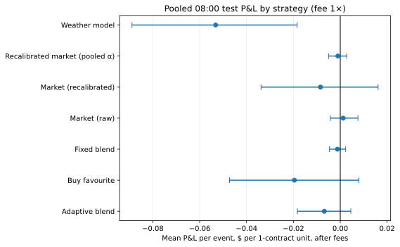
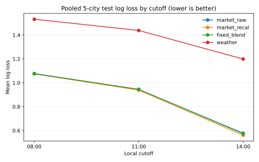
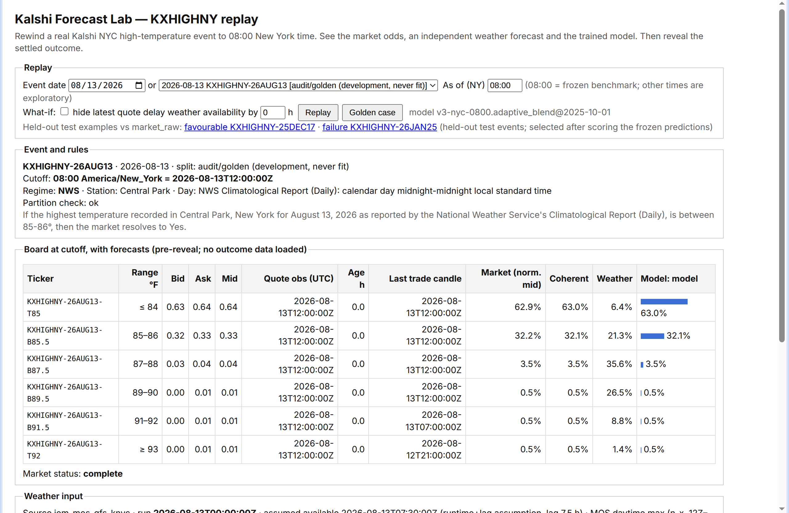

# Kalshi Forecast Lab

[](https://github.com/SPatel2133/Kalshii/actions/workflows/ci.yml)

**Can a weather model beat a prediction market on its own turf, and could you make money doing it?**

Kalshi lists daily contracts on each city's high temperature. This project rewinds every historical market to a fixed
morning cutoff. It rebuilds exactly what was knowable then: order-book quotes, the latest NWS forecast that had been
published, and observations so far. It then compares the market against weather models, learned blends, and fee-aware paper
trading strategies, all under pre-registered, leakage-guarded evaluation.

**Answer, from three versioned experiments:** no. Across 6 cities and about 1,400 held-out events, nothing beat the market by a
meaningful margin, and no strategy made supported money after Kalshi's fees. Building the measurement carefully enough to
trust a null result is the point of the project.

Research only: public read-only data, no trading, no credentials.

## Results

| Experiment | Question | Held-out result |
|---|---|---|
| [v1](evidence/nyc-0800-v1/REPORT.md) NYC, 287 events | Does an adaptive market + weather blend beat a fixed blend? | No: Δ = +0.0001 nats, 95% CI [−0.00005, +0.0003]. The fixed blend puts 100% weight on the market. |
| [v2](evidence/nyc-0800-v2/REPORT.md) NYC, 287 events | Do a full-day forecast proxy and morning observations help? | Weather model improves by 0.16 nats (CI [−0.22, −0.10]), but it still trails the market (1.44 vs 0.99), and blends stay ≈ market. |
| [v3](evidence/v3/REPORT.md) 5 new cities, 1,140 events | Pre-registered: does sharpening market odds (p^α, α ≈ 1.2) help, and is it profitable after fees? | Log loss Δ = −0.0063, CI [−0.0146, +0.0016]: not supported. P&L = −$0.0010 per event, CI [−0.0049, +0.0028]: no supported profit. |

<p align="center">
  
  
</p>

The weather model loses money (−$0.053 per event), and buying the favourite breaks even before fees but loses after them.
Later in the day the market's lead over the weather model *grows*, from 0.46 to 0.62 nats. The exploratory 14:00 cutoff shows
the strongest calibration gain (Δ −0.019, CI excludes 0), which is the hypothesis for a future pre-registered test.

## How it works

```
Kalshi archive (catalogue + hourly candles)    IEM: GFS MOS forecasts, ASOS observations
          │                                                │
          ▼                                                ▼
 rules parser ── settlement regime, station, buckets   strict as-of selector (runtime + 7.5 h lag,
          │                                              obs ≤ cutoff − 10 min, NWS LST climate day)
          └──────────────► as-of snapshot at 08:00 local ◄─┘   (labels kept in a separate file)
                                   │
          market · recalibrated market · weather (censored-normal) · coherent · fixed / adaptive blends
                                   │
          chronological 5-fold OOF fit ─► frozen state ─► sealed test predictions (sha256 before scoring)
                                   │
          log loss + calendar-block bootstrap CIs      fee-aware paper backtest (label-blind decisions)
```

Engineering choices worth a look:
- **Leakage guards.** Each feature row is built only from data timestamped before the cutoff. Labels live in a separate file, and the
  decision function has no label argument; a test asserts this. Pre-reveal API responses are checked against an allowlist.
- **Pre-registration.** v3 committed its hypotheses, splits, thresholds and strategy rules
  ([docs/v3-preregistration.md](docs/v3-preregistration.md)) before any test scoring. Development fits and frozen trading margins
  were committed next, then test scoring, and the commit history shows that order.
- **Statistics.** Paired moving-block bootstrap over calendar dates (7-day primary, 3- and 14-day sensitivity). Same-date events
  across cities stay in one block because weather is correlated. Holm correction for per-city tests.
- **Realistic costs.** Kalshi's official taker fee, ceil-to-cent(0.07·C·P·(1−P)) ([docs/fees.md](docs/fees.md)), with 0×/2× fee,
  +1¢ slippage and liquidity sensitivities.
- **Reproducibility.** Every HTTP response is cached by request key with sha256 manifests. Rebuilds are byte-identical (tests check
  feature hashes and golden replay fingerprints), and the per-event evidence is committed as deterministic gzip with checksums.
- **Data audit findings, fixed rather than ignored.** Kalshi switched settlement source from the NWS to The Weather Company on
  2026-08-14, so only NWS-regime days are used. Candles appear only when the order book changes, so quotes carry forward under a
  24 h freshness rule. Empty books are excluded. The NWS climate day runs midnight to midnight *standard* time, which v2 got wrong
  and v3 corrects ([docs/v2-erratum.md](docs/v2-erratum.md)).

## Replay demo

A local standard-library server with a plain HTML/JS page. It rewinds a real market to 08:00, shows the market odds, the
forecast and the model's forecast, and then reveals the settled outcome on request. It also supports what-if toggles (hide the
latest quote, delay the forecast) and threshold queries.



```sh
python3.12 -m venv .venv && .venv/bin/pip install -r requirements-dev.txt
.venv/bin/python -m forecast_lab --config configs/v3-nyc-0800.toml demo --model v3-nyc-0800.adaptive_blend@2025-10-01
# open http://127.0.0.1:8765/
```

The demo and full rebuilds need the local data cache (`python -m forecast_lab --config <config> download`, about 1 h per city). Raw
Kalshi and IEM payloads are not committed because their redistribution terms are unclear.

## Reproduce

```sh
.venv/bin/python -m pytest -q          # offline; tests that need the data cache skip without it
.venv/bin/python -m ruff check .
.venv/bin/python scripts/make_figures.py   # figures from committed evidence
```

Full pipeline commands (download → build → fit → evaluate → backtest → pooled) are in [docs/CHECKPOINT.md](docs/CHECKPOINT.md);
experiment specs are in [docs/experiment.md](docs/experiment.md) and [docs/v3-preregistration.md](docs/v3-preregistration.md).

## Limitations

- Fills are assumed in full at the quoted bid/ask; the candles carry no depth. This is the main optimism in the backtest.
- MOS publication time is assumed to be runtime + 7.5 h (archive timestamps record model runtime only), with an 11 h strict rerun.
- The current fee schedule (effective 2026-07-07) is applied to the whole history.
- Weather-Company-regime days, Denver and some ambiguous older rule wordings are excluded by design.

## Layout

| Path | Contents |
|---|---|
| `forecast_lab/` | `fetch` (cache, retries), `kalshi`, `contracts` (rules → buckets/labels), `weather` (MOS/ASOS), `replay` (as-of snapshot), `dataset`, `models`, `evaluation`, `backtest`, `pooled`, `service` + `demo` |
| `configs/` | one frozen TOML per experiment / city / cutoff |
| `evidence/` | reports, summaries, sealed predictions, trades, checksums |
| `docs/` | experiment specs, pre-registration, fees, erratum, figures |
| `tests/` | offline synthetic tests and real-cache regression tests |

MIT licensed.
